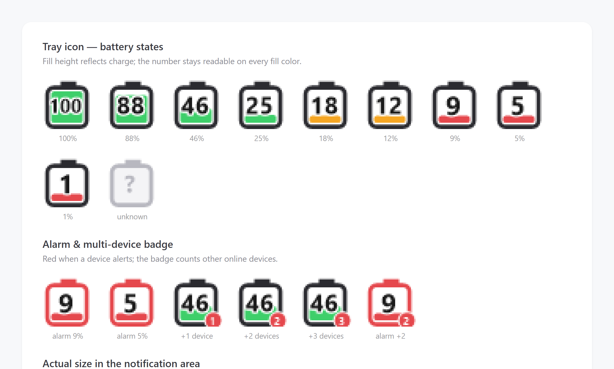
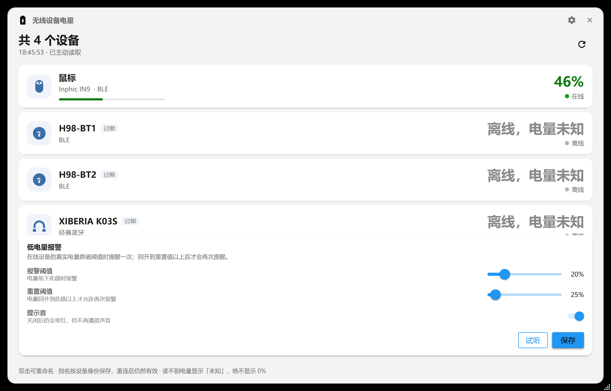
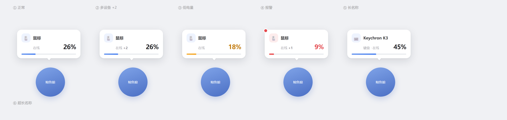

# Battery Display

[](LICENSE)
[](https://dotnet.microsoft.com/download/dotnet/8.0)
[]()

[中文](README.md) | **English**

A lightweight Windows tray utility that reports the battery level of
**2.4 GHz wireless receivers** and **Bluetooth peripherals** (mouse / keyboard /
headset) in the notification area.



---

## Features

### Live battery in the tray icon

- Win11-style vertical battery drawn at 32×32: the fill height equals the charge
  percentage, and the number is rendered inside the shell
- Three color states: green (>20%) / orange (≤20%) / red (alarm or ≤10%)
- Auto font size — `100` shrinks so it never touches the border
- Minimum 4.5 px fill, so a near-empty battery still reads as a battery instead
  of an empty frame
- Unreadable batteries show a grey `?` frame — **never `0%`**
- **Multi-device:** the icon shows the device needing attention most (alerting
  first, then lowest charge); a red corner badge counts the other online devices

### Device list window

- Material card list; light/dark theme follows the system
- Aliases are keyed by stable device identity — they survive reconnects and USB
  port changes
- Paired-but-offline devices stay listed, with their last known charge marked
  as stale
- A battery that cannot be read shows `unknown`, never `0%`

### Low battery alarm

- Adjustable threshold (default 20%) and reset threshold (default 25%)
- **Hysteresis:** alerts once per drop, and only re-arms after the charge
  recovers above the reset value or the device reconnects
- Skipped while charging
- Actions: system sound, red tray icon, red battery text
- Mute the sound without losing the visual warning
- Editable in-app via the gear button in the window header

### Quick panel

- Left-click the tray icon to pop up an online-device panel above the icon
- Does not steal focus; hides when you click elsewhere

---

## Requirements

- Windows 10 1809+ / Windows 11
- [.NET 8 Desktop Runtime](https://dotnet.microsoft.com/download/dotnet/8.0)

## Build & run

```powershell
dotnet build WirelessBatteryTray.sln -c Release
.\src\WirelessBatteryTray.App\bin\Release\net8.0-windows10.0.19041.0\WirelessBatteryTray.App.exe
```

The app starts minimised to the tray. Left-click for the quick panel,
right-click for the menu.

## Configuration

Settings and logs live in `%LOCALAPPDATA%\WirelessBatteryTray\`.

---

## About 2.4 GHz battery reporting

**Most receivers do not report battery without a vendor command.**

This project deliberately **never sends vendor commands** — a malformed report
can leave a device in a bad state.

The HID provider opens each top-level collection read-only and parses whatever
the device pushes. If the receiver never reports battery (the common case), the
device falls back to *connected, battery unknown*. Bluetooth devices use the
standard GATT Battery Service (`0x180F`) instead, which works for most BLE
peripherals.

Supporting a new receiver means implementing one method:

```csharp
// Providers/Hid24GhzProvider.cs
public static bool TryParseBatteryFromInputReport(byte[] report, out int percent)
```

---

## Screenshots

| Main window | Whale widget (optional integration) |
|---|---|
|  |  |

## Project layout

```
src/
  WirelessBatteryTray.Core/   Device abstraction layer (no UI dependency)
    Contracts.cs              IDeviceProvider / IDeviceService contracts
    DeviceService.cs          Aggregation, caching, refresh policy
    Providers/                HID (2.4 GHz) and Bluetooth implementations
    LowBatteryMonitor.cs      Hysteresis alert logic
    TaskbarHelper.cs          Taskbar geometry / DPI handling
    WhaleBridge.cs            Optional JSON bridge for a browser widget
  WirelessBatteryTray.App/    WPF tray app and UI
  BatteryProbe/               Read-only HID diagnostic CLI
```

## Diagnostics

`BatteryProbe` is read-only and **never writes to a device**.

```powershell
# List HID interfaces and sample input reports
dotnet run --project src/BatteryProbe -c Release -- --duration 10

# Run all self-checks (offline fallback / alert hysteresis / taskbar geometry)
dotnet run --project src/BatteryProbe -c Release -- --diagnose
```

## License

MIT — see [LICENSE](LICENSE). Copyright (c) 2026 1250717553-glitch.
